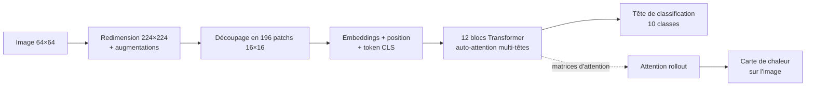

# 🛰️ ViT-Sat — Classification d'images satellite avec un Vision Transformer

> Fine-tuning d'un **Vision Transformer (ViT-B/16)** pré-entraîné sur ImageNet-21k pour reconnaître **10 types de terrain** sur des images satellite **Sentinel-2** (jeu de données **EuroSAT**).
> Le projet ajoute une couche d'**explicabilité** : la méthode d'**attention rollout** montre les zones de l'image qui ont guidé la décision du modèle.


---

## 🎯 Le problème

Classer automatiquement une image satellite (forêt, rivière, zone industrielle…) sert à la **cartographie de l'occupation des sols**, au **suivi de l'agriculture** ou à la **détection de l'urbanisation**.
EuroSAT contient **27 000 images** (64 × 64 px) réparties en 10 classes :

| Classe | Libellé | Classe | Libellé |
|---|---|---|---|
| AnnualCrop | Cultures annuelles | Pasture | Pâturage |
| Forest | Forêt | PermanentCrop | Cultures permanentes |
| HerbaceousVegetation | Végétation herbacée | Residential | Zone résidentielle |
| Highway | Autoroute | River | Rivière |
| Industrial | Zone industrielle | SeaLake | Mer / lac |

## 🧠 Comment ça marche



**Choix techniques**

- **Transfer learning** depuis `google/vit-base-patch16-224-in21k` (86 M paramètres), avec option de **gel des premiers blocs** (`--freeze-layers`)
- **Augmentations adaptées aux vues aériennes** : retournements horizontaux et verticaux, **rotations de 90°** (une image satellite n'a pas de « haut »), variations de couleur
- **Découpage stratifié** 80 / 10 / 10 : chaque classe garde la même proportion dans train, validation et test
- Optimiseur **AdamW** + learning rate avec **warmup puis décroissance en cosinus**, **label smoothing**, **gradient clipping**
- **Précision mixte (AMP)** automatique sur GPU
- Sauvegarde du **meilleur modèle sur la validation**, puis évaluation finale sur un **test jamais vu**

**Explicabilité — attention rollout** ([Abnar & Zuidema, 2020](https://arxiv.org/abs/2005.00928))
On multiplie les matrices d'attention de toutes les couches (en tenant compte des connexions résiduelles) pour estimer l'importance de chaque patch pour le token `[CLS]`. Résultat : une carte de chaleur qui montre, par exemple, que le modèle regarde bien le tracé de la rivière et pas le champ voisin.

## 🚀 Utilisation

```bash
git clone https://github.com/mayssadhahri1/vit-satellite-classifier.git
cd vit-satellite-classifier
pip install -r requirements.txt
```

### Entraîner

```bash
python -m vitsat.train --epochs 5 --batch-size 32            # entraînement complet (GPU conseillé)
python -m vitsat.train --subset 0.1 --epochs 1               # essai rapide sur 10 % des données
python -m vitsat.train --tiny --subset 0.05 --epochs 1       # test du pipeline sur CPU (mini-ViT)
```

Le script télécharge EuroSAT, entraîne le modèle et écrit dans `outputs/` :

| Fichier | Contenu |
|---|---|
| `best/` | Meilleur modèle (format Hugging Face) |
| `metrics.json` | Précision, perte, historique et rapport par classe (précision, rappel, F1) |
| `courbes.png` | Courbes de perte et de précision |
| `matrice_confusion.png` | Matrice de confusion sur le test |

> 💡 **Sur Google Colab** (GPU T4 gratuit) : `Exécution → Modifier le type d'exécution → GPU`, puis
> `!git clone https://github.com/mayssadhahri1/vit-satellite-classifier.git && cd vit-satellite-classifier && pip install -r requirements.txt && python -m vitsat.train`

### Prédire

```bash
python -m vitsat.predict outputs/best mon_image.jpg
# Affiche les 3 classes les plus probables avec leur pourcentage,
# puis enregistre la carte d'attention dans attention.png
```

### Démo web

```bash
python app.py      # http://localhost:7860
```

L'interface Gradio affiche les 3 classes les plus probables et la carte d'attention du modèle.

## 🧪 Tests

Les tests utilisent un **mini-ViT** (quelques milliers de paramètres) : ils tournent en quelques secondes, sans GPU et sans téléchargement.

```bash
pip install -r requirements-dev.txt
pytest -q      # 11 tests
ruff check .
```

Ils vérifient notamment : la forme des sorties et des attentions, le découpage stratifié sans fuite de données, l'attention rollout, le gel des couches, le planning du learning rate, et que **la perte baisse vraiment** pendant l'entraînement.

## 📁 Structure

```
vitsat/
├── data.py        # Classes, augmentations, découpage stratifié, DataLoaders
├── model.py       # Construction du ViT (pré-entraîné ou mini-ViT de test)
├── engine.py      # Boucles d'entraînement (AMP, clipping) et d'évaluation
├── train.py       # Script d'entraînement complet + courbes + matrice de confusion
├── attention.py   # Attention rollout et superposition de la carte de chaleur
└── predict.py     # Prédiction sur une image
app.py             # Démo Gradio
tests/             # Tests unitaires
```

## 🛣️ Pistes d'amélioration

- Comparer avec un CNN (ResNet-50) et un ViT plus léger (DeiT-Tiny) : précision, taille, vitesse
- Utiliser les **13 bandes spectrales** de Sentinel-2 (pas seulement RGB)
- Export **ONNX** et quantification pour un déploiement léger

---

👩‍💻 **Mayssa Dhahri** — Élève-ingénieure en Génie Logiciel, École Polytechnique de Sousse
[LinkedIn](https://www.linkedin.com/in/mayssa-dhahri/) · [GitHub](https://github.com/mayssadhahri1)

*Réalisé avec l'aide d'un assistant IA.*
